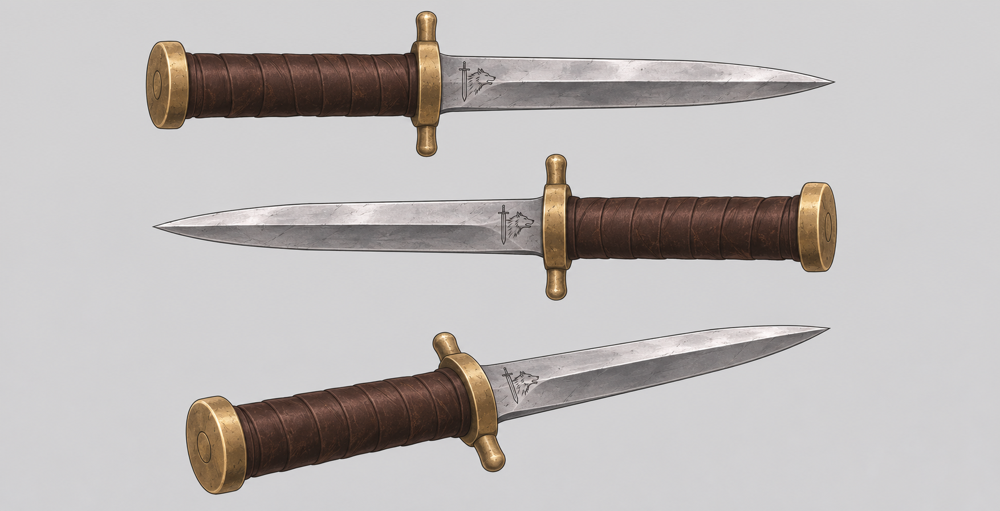

# P01 剑狼短刀

这是本项目用于后续制作的统一道具设定，来自第七章第9节分镜v2。2026-11-12，用户要求把这版小刀加入设定集，方便后续参考。采用现有图，不重新设计外形。

## 外形与比例

| 部位 | 固定特征 |
| --- | --- |
| 刀刃 | 短直双刃钢刃，尖头；刀根保留小型剑狼纹样。 |
| 握柄 | 深棕色皮革缠绕，短直圆柱柄。 |
| 护手 | 朴素黄铜短护手，两端短小圆润；不加雕花或长弯钩。 |
| 柄尾 | 扁圆黄铜圆盘；不用球形、宝石或装饰头。 |
| 比例 | 制作基准约23厘米总长，柄约9厘米、刃约13厘米，护手约4.5厘米宽。尺寸为本项目绘图参考，原著未给出这些数字。远近和透视可以改变屏幕尺寸，结构比例不随意变化。 |

原著依据：第2节提到皮革刀鞘中的小短刀；第6节说明刀上刻有剑狼国徽。参考图未画刀鞘，画面需要刀鞘时按皮革材质处理，不把额外装饰当作原著事实。

## 插刀与持有状态

生成时同时引用本图、角色设定和相邻镜头。手持、入鞘、刺入或掷出都使用同一把刀；不能在持有人腰间与被刺者身上复制。

刺入后，刀轴应进入身体体积，短柄按肩面或背面的方向向外突出；护手贴近衣料小裂口，外露钢刃以不超过约1厘米为制作起点。按动作和透视检查遮挡，避免漂浮、平贴衣服、插在颈根或无依据贯穿身体。血迹克制，不展示创口内部。

左右以角色身体为准。先从头颈、胸背、肩和手臂判断朝向，再定位伤口；画面左、近镜一侧或侧卧时朝上的肩膀，不一定是角色右肩。伤口与包扎随身体转动，遮挡时允许看不见，不能为展示细节换到另一肩。

## 第9节连续性记录

| 阶段 | 状态 |
| --- | --- |
| 01—04镜 | 本轮右肩尚未受刀伤，后背无新刀伤。 |
| 05—13镜 | 刀留在昴身体右肩前外侧，同一入点随坐、躺和转身变化；背部尚未中刀。 |
| 14—27镜 | 右肩已做简易应急包扎，身上不留刀；远侧包扎可被身体遮住，左肩不补包扎。 |
| 28—30镜 | 同一把小刀新中后背肩胛附近，右肩旧包扎仍在。v2图稿统一用右肩胛上部入点；原文未说明背伤左右，口播不擅加左右。 |
| 31—32镜 | 右肩旧伤与背伤仍在。背部不入画时不强行露刀柄，不补画原文没有交代的拔刀过程。 |

这张表只适用于第9节这轮事件。后续剧情需重新核对原文，不能默认昴一直带着这些伤势。

## 来源

- 图像：第9节分镜v2的 `references/dagger-canonical.png`，归档时逐字节复制。
- 原著：`source/novel/chapter070/02.md:627`、`06.md:353`、`09.md:201—227`、`09.md:535`、`09.md:817—823`。
- 参考图表现同一把刀的两个侧面和三分之四视角，不是三把不同小刀。
