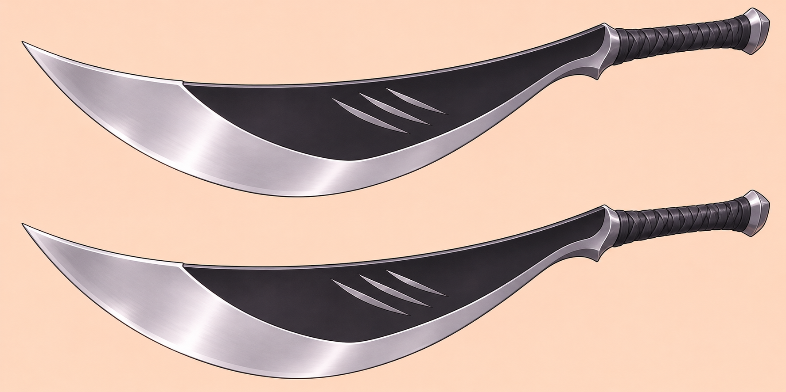

# P02 米迪娅姆的双蛮刀

第七章第18节 V2 按第16节腰间双刀的描写和第18节插图制作这张设定。两把外形和长度一致。黑色刀身在前端展开为宽弧刀腹，银色刃面沿外弧收向尖端，宽处有三条斜短槽。短柄缠深色皮革，刀根保持紧凑。配色和部分柄尾细节是项目绘图决定，原著未给具体尺寸。

按设定图的正侧面量，最宽处约为刀根到刀尖长度的五分之一。刀柄约一掌长，连柄总长与从腰侧到膝上相当。第18节已确认的第24镜可作手持参照。换机位时沿用同一轮廓，按刀面的朝向处理透视。

第18节第16镜架刀时只拿出一把，20A擦响双刀，22至24双手各持一把。26、27随米迪娅姆回车，28两把刀放在货厢里。29A以后昴只捡起一把挡斧，33最终松手。画近景时沿手腕、握柄、刀根和刃面检查器物连接。远景可以省略三条斜槽，保留宽腹和银刃轮廓。贾马尔的窄直剑按他的设定画。

原著依据见第16节第273至277行、第18节第659至663、719至739、849至851、885至889行。[第18节插图](https://github.com/re-zero-khis/re0-web/blob/master/mdbook/src/res/imgs/article/chapter070/27-008.jpg)
