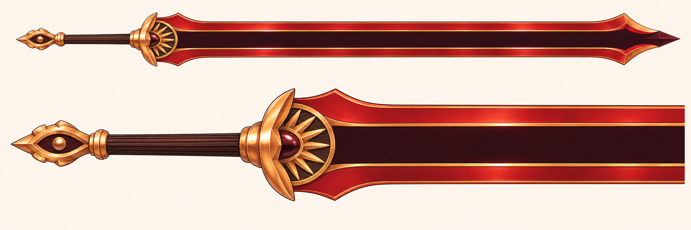

# P03 普莉希拉的阳剑

上排是全剑的侧视图，下排放大同一把剑的柄尾、护手与剑根。刃身中段宽而平直，深色剑面两侧是宽赤红刃面。剑根外扩，贴着带三角放射纹和中央凸饰的半日轮。金色护手中部隆起，两翼收尖。细长深色握柄接金色尖环柄尾，环内有深色凹面和中央小凸饰。靠剑尖的一段先向两侧形成一对短折角，随后向中轴收尖。

第27卷初登场插图和第30卷插图用于核对剑根、日轮、护手和柄尾。全剑轮廓和配色以大塚真一郎绘制的第37卷官方彩色封面为准，封面火光盖住了剑尖最末一点，设定图按两侧可见轮廓收尖。[第27卷插图](https://raw.githubusercontent.com/re-zero-khis/re0-web/master/mdbook/src/res/imgs/article/chapter070/27-014.jpg) · [第30卷插图](https://raw.githubusercontent.com/re-zero-khis/re0-web/master/mdbook/src/res/imgs/article/chapter070/30-009.jpg) · [角川第37卷封面](https://cdn.kdkw.jp/cover_1000/322311/322311001287.webp)

原著第24节第1175行写她右手举起泛赤辉的剑，第25节称它为「阳剑」。第57B节写宝剑赤光流转并缀有宝饰。网文第五章第63节形容它自柄至刃通红，本设定图的深色剑面、赤红刃面和金色配件依书籍版彩绘。[第五章第63节原文](https://ncode.syosetu.com/n2267be/380/)

第24节第38镜从背影切到回眸，普莉希拉一直用右手持剑。换机位时按中轴检查握柄、护手与剑身的连接，保留两端外扩、深色剑面及赤红刃面。剑尾的环形凹面和中央凸饰在近景中应能辨认。
