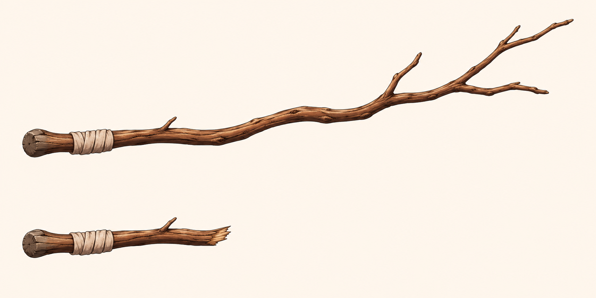

# P04 亚拉基亚的树枝

上方是完整长枝，下方是同一根枝条的短态。长枝为棕色薄皮，枝身轻弯，握端稍粗且钝圆，握端附近缠一小段浅米褐旧布。主杆沿末端逐渐变细，远端有一对错落的主分叉，枝身上还有数个很短的枝芽，构成不对称轮廓。用作同一分镜中的道具时，改变视角仍保留弯势、主分叉、握端布缠与原有比例。

短态约为长态可见长度的四成，留着原来的粗握端、布缠和靠近握端的小岔枝。远端断口露出较浅的木色。投飞时优先保住树枝全形，前后镜用同一状态。

第 25 节原著写到亚拉基亚松开细长枝条、枝条飞向埃布尔、又回到她手边。它在击飞米泽尔妲的匕首时已经折短。第 26–28 镜中，按本节画面要求，贯入后的枝身不在画面中出现。棕色树皮、分叉和布缠为本项目的视觉设定。[第 25 节原著](../../../../../source/novel/chapter070/25.md)
