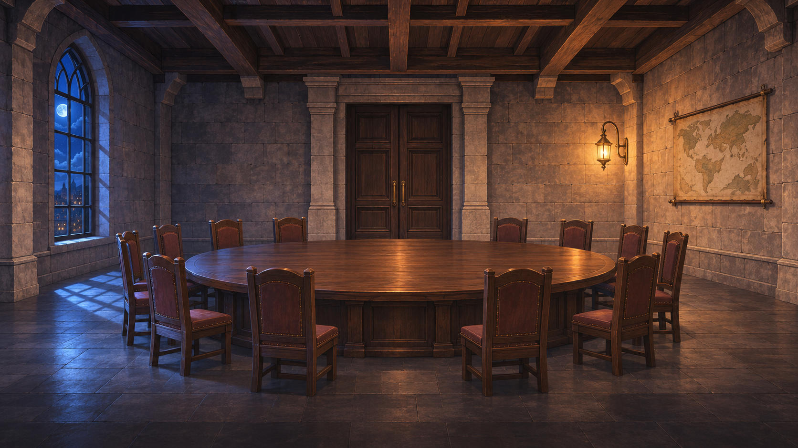
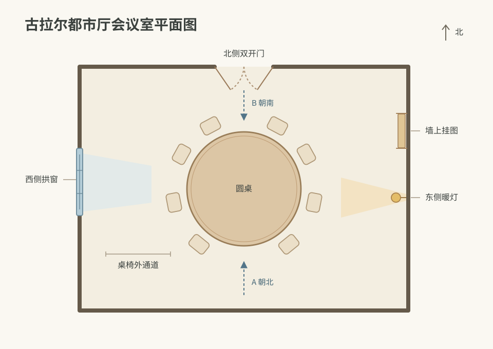

# 古拉尔都市厅会议室

这是要塞都市古拉尔的都市厅内，用于重要会谈的圆桌会议室。项目沿用第 26 节制作记录中的北门、西窗和东侧暖灯，第 28 节据此重建会场彩图。本条目以第 28 节母图作为后续分镜的空间和材质参考。 [第 26 节圆桌复盘](../../productions/chapter070/section26/retrospective.md#开场与圆桌) · [资产清单](../../../data/source-webp/chapter07/settings/scenes/gurall-council-room/manifest.json)

## 参考图

**空景母图。** 从南向北看，左侧是西窗，中央是北门，右侧是暖壁灯和东墙挂图。可直接用作后续出图的会场参考。母图采用第 28 节开会前段的挂图状态。

**通用平面图。** 北朝上，可用来核对门、窗、灯、桌和进出路线。椅位和通道按图示理解，具体间距随镜头所需的坐姿和走位调整。

**反打范例。** 第 28 节已采用分镜 V4 第 17 镜，从北向南拍，暖灯在画左，西窗在画右。可参考桌椅与人物的比例、近侧站位和南墙石柱。这一帧的坐席和道具对应当场会谈进度。 [第 28 节制作复盘](../../productions/chapter070/section28/retrospective.md#分镜返修)

## 空间与外观

| 部位 | 项目采用设定 |
| --- | --- |
| 北侧 | 深色双扇木门，四周为厚石门框。北门到桌沿之间留出入场、停步和绕桌的空间。 |
| 西侧 | 高窄尖拱窗带深色窗格。夜景中冷蓝窗光斜落在石地、椅背和圆桌西缘。窗外的天色、天气和亮度随当期时段设置。 |
| 东侧 | 暖色壁灯照亮石墙和桌面东缘。东墙可悬挂卷轴式世界地图。地图取下后，墙面挂图处相应空出，桌面上按动作依次出现纸卷和铺平的地图。 |
| 中央 | 厚桌沿的深棕木圆桌，下部为分块围板。周边配深木高背椅，坐垫和椅背用暗红皮面，边缘有细小钉饰。椅面低于桌面，椅脚落地，桌椅之间留入座和起身的间隙。 |
| 墙面和顶地 | 灰棕石块砌墙，石柱和石饰局部凸出。地面铺大块深灰石板，顶上是外露的深木梁和木板。色温随西窗与东灯的照明方向变化。 |

## 原著依据

- 亚拉基亚袭击后，都市厅上部受损，坚固的基座使室内会谈用房仍可使用。会议室内摆有大圆桌。第 29 节一行人从会议室前往都市厅上层的临时救治处。 [袭击后的会议室](../../../source/novel/chapter070/26.md#L283) · [前往都市厅上层](../../../source/novel/chapter070/29.md#L397)
- 第 28 节的世界地图挂在会议室墙上，士兵取下后在圆桌上展开。墙面方位、门窗形制、家具材质和打光均为项目美术设定。 [取下世界地图](../../../source/novel/chapter070/28.md#L489)

## 分镜复用

- 先看空景与平面图，按当段剧情登记出席者、座位、站位、守卫与道具状态。第 28 节接续第 26 节的圆桌座次，普莉希拉坐西席，埃布尔坐东席，南侧由西到东为库娜、兹克尔、昴。人物离席后，在邻镜保留同一把空椅。其他时段按当段原著和已采用的接点安排。 [第 26 节座次](../../productions/chapter070/section26/retrospective.md#开场与圆桌)
- 南机位朝北，西在画左、东在画右。北机位朝南，东在画左、西在画右。需要越到桌的另一侧时，用能看见桌沿、座次和固定地标的全景或高位镜头交代空间。人和物的世界位置按平面核对。
- 门边保留进出通道。近景看坐垫是否承住身体，桌沿能否自然遮挡，桌椅间距能否支持起身、靠近和递物。地图上桌时，连看取下、持卷、铺平后的墙面与桌面。把本次实际挂给生图的参考图记入分镜。 [设定集索引](../../../data/source-webp/chapter07/settings/README.md)
