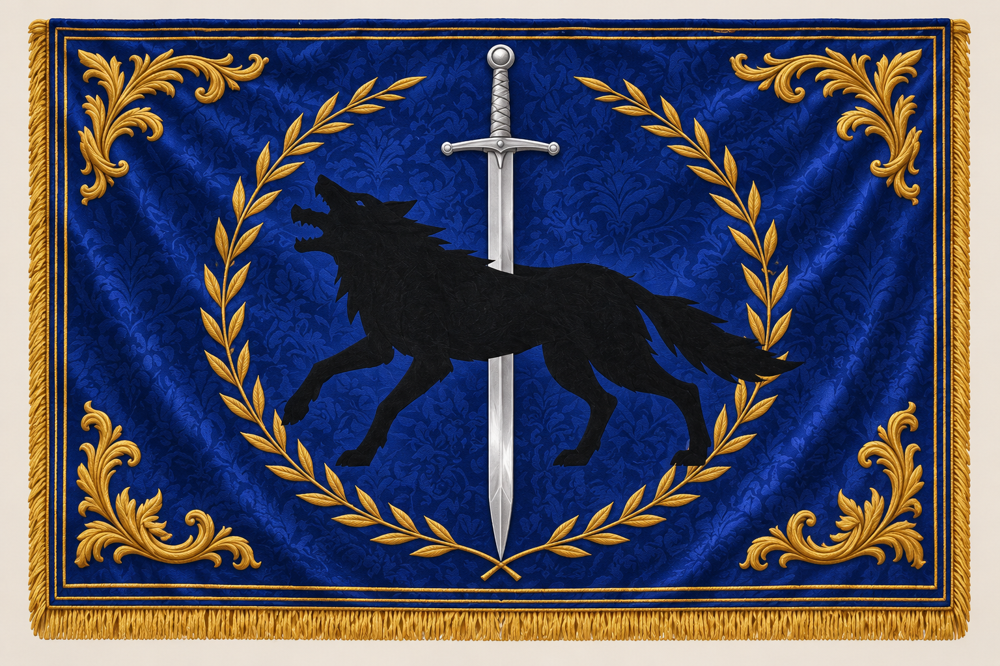
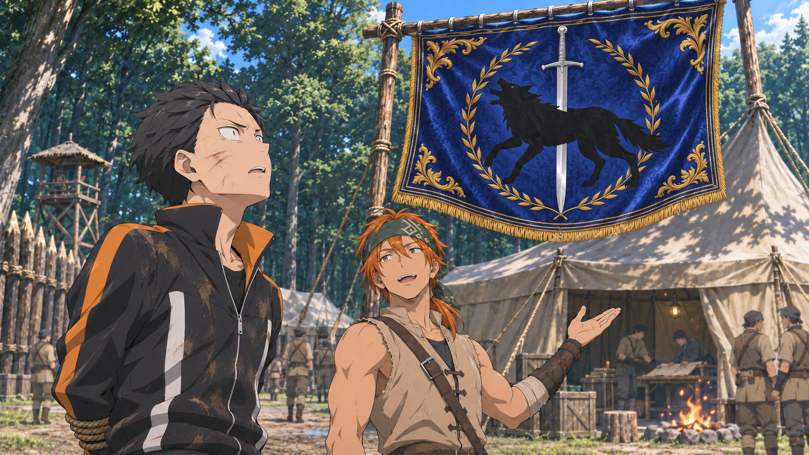

# 佛拉基亚帝国旗帜

后续帝国篇分镜、封面和相关视觉素材，默认使用第六节已采用的深蓝金绣帝国旗。用户于2026年11月10日要求将这版形象保存为项目设定，沿用至用户修订或剧情明确需要其他旗帜时。

资产版本：`vollachia-imperial-flag-v1`。图稿与来源见[资产清单](../../../data/source-webp/chapter07/settings/flags/manifest.json)。

## 参考图

上图供后续生成时引用。旗面正面展开，便于核对徽记与金色纹饰；场景中的风向、透视和褶皱可以变化。

场景母图来自第六节分镜第13镜，第二、三版沿用同一张图。独立参考图由这张母图整理；细节有疑义时回看母图，不另换一种国旗设计。

## 固定外观

| 部位 | 本项目采用的设计 |
| --- | --- |
| 底色与材质 | 深钴蓝丝缎，带低对比度的植物暗纹；明暗随光线变化，保留蓝色识别 |
| 主徽记 | 黑狼朝正面观看者的左侧；银色直剑竖向贯穿狼身，剑柄在上、剑尖向下 |
| 月桂环 | 金色枝叶从两侧包围主徽记，上方留开口，下端交叠 |
| 边框 | 细致的双道金线矩形绣边 |
| 四角 | 对称金色卷草纹，位于旗面边框以内 |
| 边缘 | 左、右及下边缘为短金色流苏，上沿按悬挂方式处理 |
| 文字 | 旗面不加文字、编号或标语 |

不指定原著未提供的官方长宽比或精确色值。正面工作图的比例是制作参考，入镜时按透视和布料受力调整，保持徽记与装饰布局。

## 原著依据与美术补充

[第六节原文](../../../source/novel/chapter070/06.md)第367—381行写到蓝色旗帜，中央是被利剑贯穿的黑狼，昴据此认出神圣佛拉基亚帝国。

蓝色旗、黑狼和贯穿狼身的利剑来自原文。深钴蓝、丝缎暗纹、银剑的具体外观与朝向、狼的朝向、月桂环、金绣边框、卷草纹和流苏，是本项目根据用户要求采用的美术设计；解说不得将这些补充描述成原著明确记载或官方旗帜规格。

## 场景使用

生成前同时查看独立正面图和场景母图，并把参考图作为图像生成或编辑的输入。近景保留主要纹饰和布料细节；中远景可以减少暗纹、枝叶和流苏的描绘量，但保留蓝底、黑狼、贯穿的剑及金色边缘。

不同镜头可调整旗杆、横梁、悬挂、风向和褶皱，不凭场景重画另一套徽记。镜头从旗帜背面观看时，允许图案随布面翻转，前后视角需要保持一致。

医帐红旗按原文保留，不套用帝国剑狼纹饰。其他势力、军团或人物专用旗帜如有明确来源，另建设定，不沿用这面旗冒充。

短刀等物件上的剑狼国徽按物件本身表现，不自动添加整面旗帜的布纹、边框或流苏。

## 逐镜检查

- 蓝色旗底、黑狼和银剑都清楚，狼未变成鹰、狮、龙、树形或星形图案。
- 正面视图的狼朝向、剑的上下方向与参考图一致；背面翻转有相应机位依据。
- 金月桂环、双绣边、卷草角和短流苏保持同一套设计，近远景差异由距离解释。
- 纹饰随旗面褶皱与透视变化，旗杆、横梁等接触和悬挂成立。
- 旗面没有新增文字或无来源图腾，红旗医帐没有混用。

本次采用范围仅为国旗视觉设定；各节分镜和视频仍按项目审稿流程分别确认。
